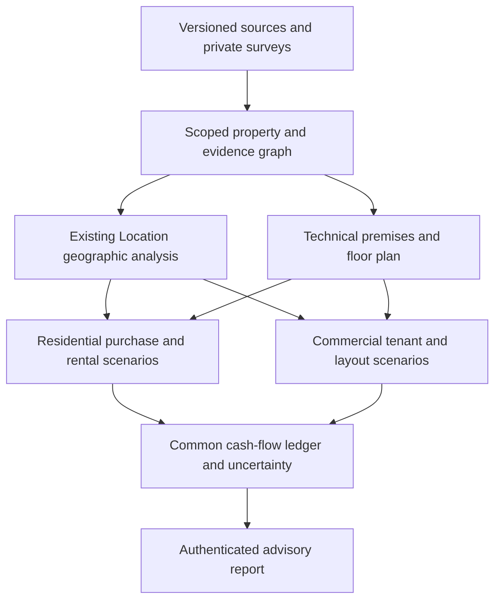

# Unified residential and commercial intelligence — architecture v1

Status: internal offline advisory vertical slice. Design and source review dated 2026-10-15. Baseline PR462 `3cca50ef217f71aa41badd85873d597441fa91c0`, following PR461 and earlier residential/commercial work. This is neither a new address scorer nor a production underwriting service. The historical 44/56 residential calibration result remains HOLD; no golden expectation, scoring cap, payment entitlement or Custodian policy is changed.

## Product decision

One property identity and evidence graph feeds separate scenario models. A residential buyer, long-term landlord, short-term operator and commercial subdivider share geography, not revenue formulas or a universal score. Compare scenarios by explicit cash-flow assumptions and uncertainty, while retaining nonfinancial and legal constraints. A high modeled return cannot cancel an unresolved building identity, restricted use or unsafe entrance.

No arrow grants execution authority. Booking Ops, paid report access and Custodian continue using their existing independently checked boundaries.

## Reuse, not parallel scoring

Existing `location/address-providers/geocode-pipeline.ts` owns normalized address resolution/provider policy. `location-decision-contract.ts` separates scored property point from nearby POIs. `unified-report.ts` owns goals, evidence, limitations and report sections. `gravity-scoring.ts`, `foot-traffic.ts`, H3 and heatmaps remain shared modeled signals. Existing `commercial-format-fit.ts` six categories and `street-retail-suitability.ts` floor/frontage restrictions remain advisory context. Existing residential strategy and purchase quality scores remain quality signals, never automatically converted into rent or profit.

The additive module `src/lib/real-estate-intelligence` accepts an immutable `SharedProperty`, optional existing `LocationAnalysis`, explicit `Economics` and scenario inputs. It has no provider, database, message, entitlement or executor imports. Account/property/revision equality checks are defensive consistency checks, **not authentication**. Future routes must derive scope from the authenticated session and enforce existing paid-report access before accepting or returning private facts.

## Target data model and ownership

| Entity | Key fields and relations | Current slice / next gate |
| --- | --- | --- |
| AddressIdentity | stable address/building/corpus/unit IDs; WGS84 point; candidate identities; resolution method | Slice carries property/address/geography revision and unresolved hold; reuse actual geocoder, do not fabricate coordinate precision |
| GeoSnapshot | immutable revision, time, source set, geometry coverage, CRS, point-vs-entrance distinction | Optional existing LocationAnalysis is explicitly model context; target canonical geo snapshot adapter needs benchmark gates |
| Evidence | digest, source locator, kind, dates/expiry, rights, scope, field derivations, reliability | Slice implements digest/locator/kind/date/rights and fact refs; digest syntax does not authenticate source contents; target signed acquisition receipt and source registry |
| Property | account/property/revision, address identity, use, power, measured traffic, premises | Implemented internal type; private survey facts never share cache with public POIs |
| PremisesSurvey | floor, first line, frontage/windows, entrances/steps, ceiling, usable/common area, fit-out, walls, power, water, exhaust, access | Slice reuses existing premises type plus cell geometry and utilities; ceilings, detailed structural/egress paths, fit-out bill of quantities still absent |
| LegalConstraint | title/lease/sublease rights, permitted use, servitudes, approvals, validity and professional verifier | Slice explicit permittedUses fact + permanent legal-signoff hold; no automatic legal approval |
| FloorPlanRevision | measured source, units/scale, metric cells or polygons, structural boundaries, corridors, entry nodes | Slice rectangular cells with unequal connected unions and excluded common areas; no image-to-CAD inference |
| LayoutCandidate / Unit | geometry membership, rentable/common area, access route, shared capacities, constraint status | Slice bounded graph partitions; technical conditional candidates only, never certified feasible layouts |
| TenantCategory / TenantEvidence | category, area/frontage/windows, utilities, use, competitors, demand, sales/affordability, rent, default/concentration | Slice explicit requirements and rent/vacancy/collection/fit-out assumptions; existing demand fit returned separately, not an invented rent adjustment |
| ScenarioRevision | property/geo/plan/economics revisions, use mode, inputs, assumptions, output, sensitivity | Residential purchase/LTR/STR and commercial whole-vs-split functions; scenario persistence and report API not shipped |
| CashflowPeriod | gross, opex, head rent, operating surplus, tax proxy, debt, investment, refundable liabilities, cash | Shared deterministic ledger; restricted deposits excluded from return/peak-funding relief |
| AcceptanceRecord | exact code/input hashes, tests, reviewer, geography/engineering/legal/financial gates | CI receipt and report bundle; code PASS is not commercial or physical readiness |

Target missing facts use `unknown` with reason, never zero. Separate observed facts, owner declarations, model estimates, course heuristics and synthetic fixtures. Source quality has multiple dimensions (identity, date, completeness, method, license); do not collapse these to a percentage that erases missing legal evidence. Preserve disagreements as competing observations, not latest-write-wins truth.

## Geographic and demand pipeline

Resolve the actual building/unit, then entrances and reachable surroundings. Keep geodesic distance, network walking route, accessibility route and time-specific traffic distinct. Barriers include water, grade, rail, closed compounds, legal crossings and opening hours. Existing barrier heuristics are not walking verification. H3 resolution/coverage/truncation and map legend must accompany heatmaps. Existing magnet influence is a modeled layer; a measured people/hour layer requires counts with time, direction, station line, weather/season, weekday/weekend coverage and sampling method.

Demand categories and competition are shared observations but scenario-specific interpretations: a tourist magnet can support STR nights, destination retail visits or no passing storefront demand. Evergreen expresses modeled spatial permanence, not occupancy, sales or profitability. Monthly STR nights/ADR and commercial seasonality require dated independent series or clearly declared scenarios. Russian metro, residential, suburban, coastal, mountain/resort and small-city calibration must retain market-specific evidence; no Moscow-minus-fixed-percent defaults.

## Commercial technical and layout pipeline

1. Verify plan scale, dimensions and source revision; identify load-bearing boundaries, columns, windows, entrances, common circulation, wet cores and utility capacities.
2. Represent atomic buildable spaces and permitted merge/cut relations. Preserve irregular external geometry; do not divide total area equally.
3. Enumerate connected partitions with entrance/access and area conservation; constrain simultaneous utilities, tenant uses and common-area costs.
4. Match candidate units to tenant categories, then evaluate evidence-backed demand, competition, rent affordability, default/concentration and lease-up risk.
5. Compare whole and split with the same horizon/currency/discount basis, including additional partition capex and recurring unit costs.
6. Show rejected reasons, unknowns, sensitivity and search coverage. Engineering/legal acceptance remains independent of economic rank.

Implemented search supports at most 8 lettable atomic rectangular cells (10 total including common), 8 units and 8 tenant categories. Connected unions can be L-shaped and unequal. Adjacent cells merge only across explicit permitted graph edges; overlap and corner-only edges fail. Each unit needs a supplied allowed entrance. Global category assignment enforces total power, utility requirements, category count and optional rent-to-sales cap. Search is bounded to 50,000 nodes (default 10,000), reports truncation, and returns the best **within supplied cells/categories/assumptions**, never a global CAD optimum. Unknown plumbing/exhaust remains conditional. Supply geometry cannot prove entrance width, travel distance, fire compartmentation or service accessibility.

Next geometry version should use validated polygons, holes and robust topology with integer metric coordinates or controlled tolerance, measurable doorway/circulation graphs and engineer-reviewed hard constraints. Mixed integer/constraint search can combine cuts, tenant assignment and shared capacities with an optimality bound. Do not add an optimizer dependency until supported instance size and constraints justify it.

## Economics and uncertainty

Monthly commercial collected income = unit area × assumed rent/m² × (1−vacancy) × collection rate, zero during supplied fit-out months, escalated annually at month13. Residential LTR uses explicit rent/vacancy; STR uses month-specific available nights × occupancy × ADR. Purchase adds acquisition, financing, costs and explicit exit assumptions to the same ledger. Inputs are never derived from a course number without a heuristic label.

Gross income minus opex and head rent is operating surplus before tax/debt; it is not guaranteed NOI or net profit. Explicit revenue-based tax is a placeholder cash-tax proxy, not VAT/profit-tax determination. Unknown tax remains UNKNOWN_PRETAX_ONLY. Tenant refundable deposits are liabilities and do not reduce investment at risk or improve NPV; own deposits require funding and have an opportunity cost until return. Bank cash is shown separately from unrestricted cash. Annual effective discount uses month/12; IRR is returned only for conventional initial-negative/later-nonnegative streams and a bounded root, otherwise null. No forced annualization of ambiguous roots.

Target additional models: recoverable VAT and tax basis by verified taxpayer status; irregular dates/XNPV; debt amortization/interest/principal; rent-free schedules and step rents; lease breaks; capex contingency and depreciation; insurance/property tax/reserves; common-area utility reconciliation; deposits not returned; stochastic default/lease-up and correlated category risk. Sensitivity must vary rent, vacancy, capex, delay, discount and exit independently and jointly with provenance, not invent probabilities. Display downside liquidity/peak funding and break-even occupancy/rent, not just maximum modeled yield.

## Residential and Strigunov integration

A read-only adapter may later use authorized, deidentified Booking Ops realized nights/revenue/costs as observations. Booking identities and account scope must be revalidated at the platform boundary; no guest PII enters shared geographic caches. Existing pricing placeholders are not live market coverage. Residential purchase, LTR and STR compare shared property facts but different lease/seasonal/operating models. Commercial recommendations cannot pass through the residential-only decision adapter or enable Custodian. No host work is required for this offline layer, and no host installation readiness is claimed.

## Security and access

Private floor plans, lease contracts, financials and source samples remain account-scoped; course documents stay out of git. Public-source licenses and retention apply to derived evidence too. Import processing must reject macros/external links, zip traversal/bombs and oversized geometry; this sprint's Word reading disabled macros/links and used read-only documents. Future API schemas require strict runtime validation, request size/search budgets, authentication, entitlement checks, audit receipts, revision rechecks and no arbitrary URL fetching. A self-declared digest or `observed` tag is not proof. All current outputs set automaticActionAllowed=false and investmentReady=false.

## Delivery boundary

This sprint delivers an executable internal model and architectural seams, not automatic survey extraction, measured footfall, a commercial legal engine, authenticated UI, production deployment or calibrated economic predictions. Source course errors inform regression tests; they do not change existing Location goldens. See ROADMAP-ACCEPTANCE.md and SOURCE-AUDIT.md for gates and evidence.
